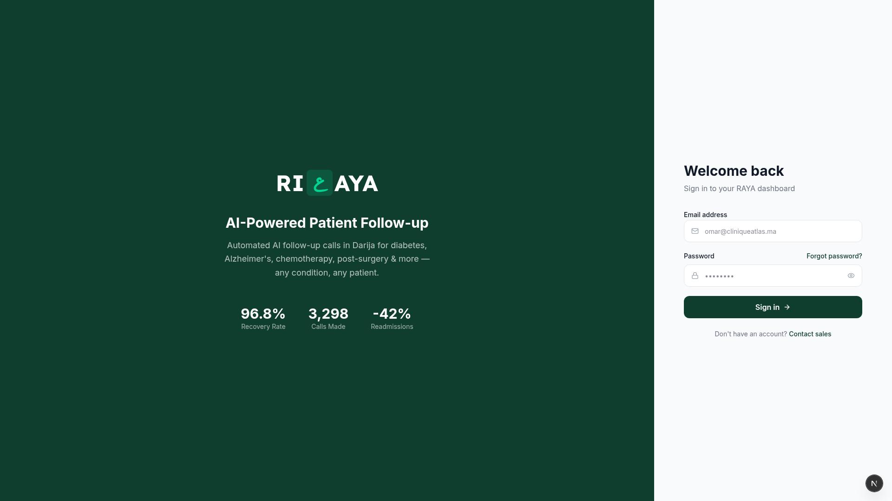
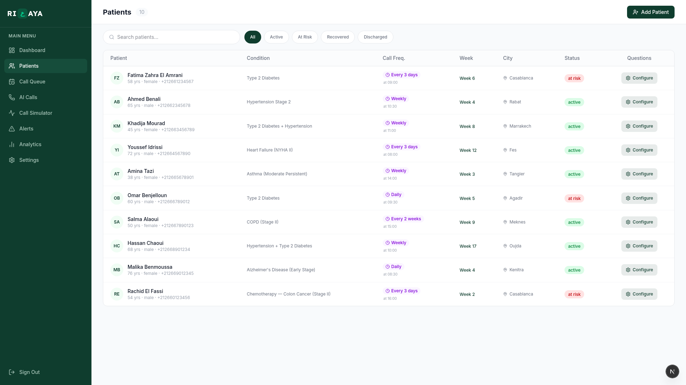
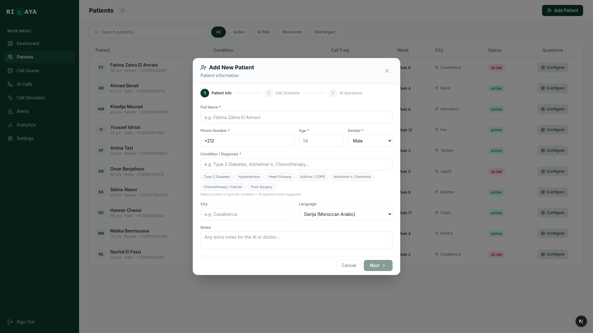
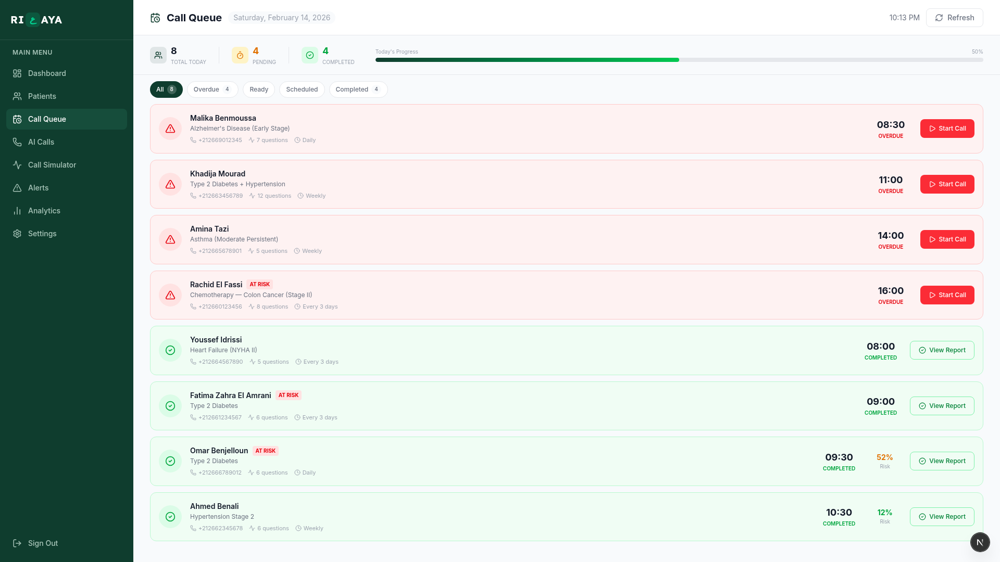
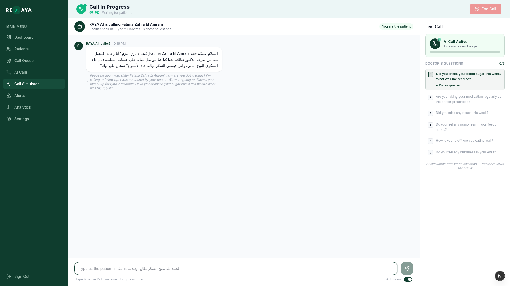

# RAYA — AI-Powered Patient Follow-up Calls in Darija

<div align="center">



**Every patient deserves follow-up.**

RAYA is an AI platform that makes automated follow-up phone calls to patients in **Darija (Moroccan Arabic)**. Doctors configure questions per patient, set call frequency, and the AI handles the rest — speaking naturally in Moroccan Arabic. After each call, the AI generates a risk evaluation, but the **doctor always makes the final decision**.

[Features](#features) · [Screenshots](#screenshots) · [How It Works](#how-it-works) · [Tech Stack](#tech-stack) · [Quick Start](#quick-start) · [Project Structure](#project-structure)

</div>

---

## The Problem

In Morocco, **700 doctors emigrate every year**. With only **6.7 doctors per 10,000 people**, patients discharged after surgery, chemotherapy, or a diabetes crisis go home with **zero follow-up calls**. Complications get missed. They end up back in the ER — or worse.

**RAYA solves this** by automating follow-up calls in the language patients actually speak: **Darija**.

---

## Features

- **AI Voice Calls in Darija** — RAYA calls patients and speaks naturally in Moroccan Arabic using Edge TTS (`ar-MA-MounaNeural`)
- **Doctor-Configured Questions** — Doctors choose exactly what to ask each patient, with condition-specific presets for 7+ conditions
- **Any Medical Condition** — Diabetes, Alzheimer's, Chemotherapy, Post-Surgery, Heart Failure, Asthma, COPD, and more
- **AI Risk Analysis** — After each call, MiniMax LLM analyzes the conversation and generates a risk score with per-question concern levels
- **Doctor Decision** — The AI suggests, but the doctor decides: Approve, Escalate (create alert), or Dismiss
- **Smart Call Queue** — Automated daily scheduling based on call frequency (daily, weekly, every 3 days)
- **Real-time Translation** — Darija → English and Darija → French live translation
- **Alert System** — Severity-based alerts when doctors escalate cases
- **Analytics Dashboard** — Patient recovery rates, call volumes, risk trends

---

## Screenshots

### Patient Management
All patients with conditions, call schedules, status, and city — filterable by status.



### Add New Patient
Doctor configures patient info, condition (with presets), call schedule, and AI questions in a guided 3-step flow.



### Call Queue
Today's calls at a glance — who's overdue, who's ready, who's completed. One-click to start a call.



### AI Call Simulator
RAYA speaks Darija in real-time. The right panel shows the doctor's configured questions being asked one by one. After the call, AI generates a full risk evaluation.



---

## How It Works

```
┌────────────────────────┐
│  1. Doctor Configures  │  Choose questions, call time, frequency per patient
└──────────┬─────────────┘
           ▼
┌─────────────────────┐
│  2. RAYA Calls      │  AI phones the patient, speaks Darija naturally
│     in Darija       │  Asks each question, handles confused/unclear answers
└──────────┬──────────┘
           ▼
┌─────────────────────┐
│  3. AI Analyzes     │  Risk score + per-question concern levels
│     the Call        │  Translates transcript to English/French
└──────────┬──────────┘
           ▼
┌─────────────────────┐
│  4. Doctor Decides  │  Approve (no action) / Escalate (create alert) / Dismiss
└─────────────────────┘
```

---

## Tech Stack

| Layer | Technology | Purpose |
|-------|-----------|---------|
| **Frontend** | Next.js 16, TypeScript, Tailwind CSS v4 | Modern responsive dashboard |
| **Backend** | FastAPI, SQLAlchemy, SQLite | REST API, ORM, lightweight DB |
| **AI / LLM** | MiniMax (primary), Groq Llama 3.3 70B (fallback) | Darija conversations, translation, risk analysis |
| **Voice TTS** | Edge TTS `ar-MA-MounaNeural` | Moroccan Arabic text-to-speech (free) |
| **Voice Fallback** | ElevenLabs | Multilingual Arabic voice synthesis |
| **Dev Tool** | Cursor AI IDE | Full-stack app built with AI in 48 hours |


### Prerequisites
- Python 3.10+
- Node.js 20+

### 1. Clone the repo

```bash
git clone git@github.com:itselcid/RAYA-AI.git
cd raya
```

### 2. Set up the Backend

```bash
cd backend

# Install dependencies
pip install -r requirements.txt

# Configure environment — copy the example and add your API keys
cp .env.example .env
# Edit .env with your keys: MINIMAX_API_KEY (required), GROQ_API_KEY (recommended)

# Seed demo data (creates demo doctor account + sample patients)
python3 seed_demo.py

# Start the server
python3 -m uvicorn app.main:app --host 0.0.0.0 --port 8000 --reload
```

### 3. Set up the Frontend

```bash
cd frontend

# Install dependencies
npm install

# Start dev server
npm run dev
```

### 4. Open the app

Go to **http://localhost:3000**

Login with the demo account:
- **Email:** `doctor@test.com`
- **Password:** `test1234`

---

## API Keys

| Service | Purpose | Get it at | Required? |
|---------|---------|-----------|-----------|
| **MiniMax** | LLM (Darija conversations + risk analysis) | https://platform.minimaxi.com | Yes |
| **Groq** | Fast LLM fallback | https://console.groq.com | Recommended |
| **ElevenLabs** | TTS voice fallback | https://elevenlabs.io | Optional |

> **Note:** Edge TTS (Moroccan Arabic voice) works without any API key — it's free and built-in.

---

## Project Structure

```
raya/
├── backend/                    # FastAPI Python backend
│   ├── app/
│   │   ├── api/                # REST endpoints (patients, calls, simulate, alerts)
│   │   ├── models/             # SQLAlchemy ORM models (Patient, Call, CallMessage, Alert)
│   │   ├── schemas/            # Pydantic request/response schemas
│   │   ├── services/           # Business logic
│   │   │   ├── minimax_service.py    # LLM chat + translation + risk analysis
│   │   │   ├── edge_tts_service.py   # Moroccan Arabic TTS (primary)
│   │   │   ├── elevenlabs_service.py # ElevenLabs TTS (fallback)
│   │   │   └── groq_tts_service.py   # Groq TTS (experimental)
│   │   └── prompts/            # AI system prompts for Darija medical agent
│   ├── seed_demo.py            # Demo data seeder
│   └── requirements.txt
├── frontend/                   # Next.js 16 TypeScript frontend
│   └── src/
│       ├── app/
│       │   └── (dashboard)/    # Dashboard pages
│       │       ├── dashboard/  # Overview with stats
│       │       ├── patients/   # Patient management
│       │       ├── queue/      # Daily call queue
│       │       ├── calls/      # AI call history + analysis
│       │       ├── simulate/   # Live AI call simulator
│       │       ├── alerts/     # Alert management
│       │       └── analytics/  # Charts and trends
│       ├── components/         # Reusable UI components (sidebar, logo)
│       └── lib/                # API client, utilities
├── screenshot_*.png            # App screenshots for presentation
├── qa_cheatsheet.md            # Q&A guide
```

---

## The Business Opportunity

- **B2B SaaS** model — sell to hospitals and clinics per patient/month
- **Market:** 32M Moroccans on AMO insurance, 150+ hospitals, 1000+ clinics
- **ROI:** 1 prevented readmission = **15,000 – 50,000 MAD** saved
- **Expansion:** Morocco → Gulf → France (diaspora) → Sub-Saharan Africa


